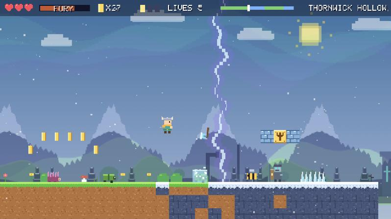

# Hopheim

**The Axe That Comes Back.** A free browser platformer where a sunny meadow world has been torn open by a frozen Norse rift.

### [▶ Play it now](https://hmaskour.github.io/hopheim/)

No install needed. Works best with a keyboard.

## The game

You play Pim, a small hero in a horned helmet, on a journey through five worlds and two boss fights. The land is 60% sunlit meadow and 40% frozen rift, and the two meet inside the levels: the sky, the snow and the music all shift as you cross over.

- **Throw the axe.** It freezes enemies and comes back to you.
- **Use what you freeze.** Stand on frozen enemies as steps, or kick them into each other.
- **Climb with it.** Stick the axe in a rune wall, stand on it, and jump higher.
- **Go berserk.** Fill your Fury bar to tear through anything for a few seconds.
- **Find the sun shards.** There are three hidden in each world.

## Controls

| Action | Key |
| --- | --- |
| Move | Arrow keys or A / D |
| Jump | Space (hold to jump higher) |
| Throw or recall the axe | X |
| Swing | C |
| Ground slam | Down while in the air |
| Berserk | V |
| Pause | P |
| Mute | M |

## Run it yourself

Download `index.html` and open it in a browser. It's one file with no dependencies: all the art is drawn in code and all the music is synthesised.

## Feedback

Found a bug or have an idea? [Open an issue](https://github.com/hmaskour/hopheim/issues).
